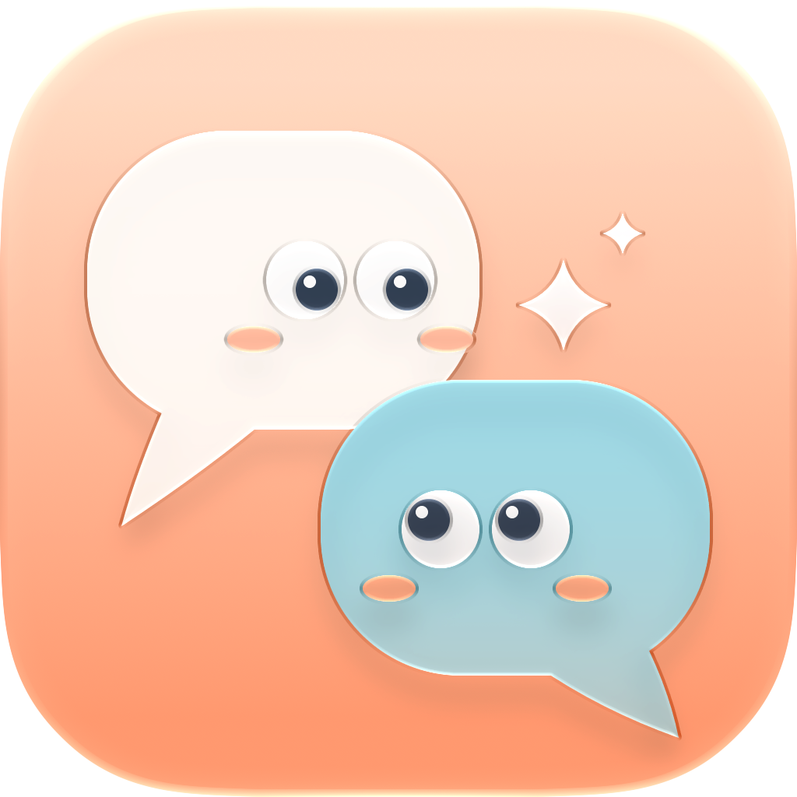
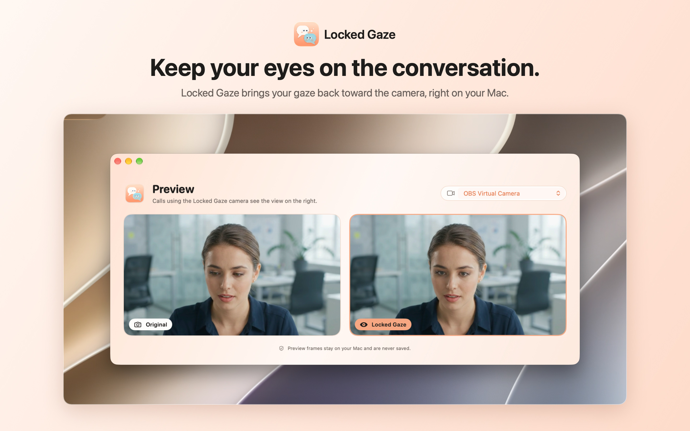
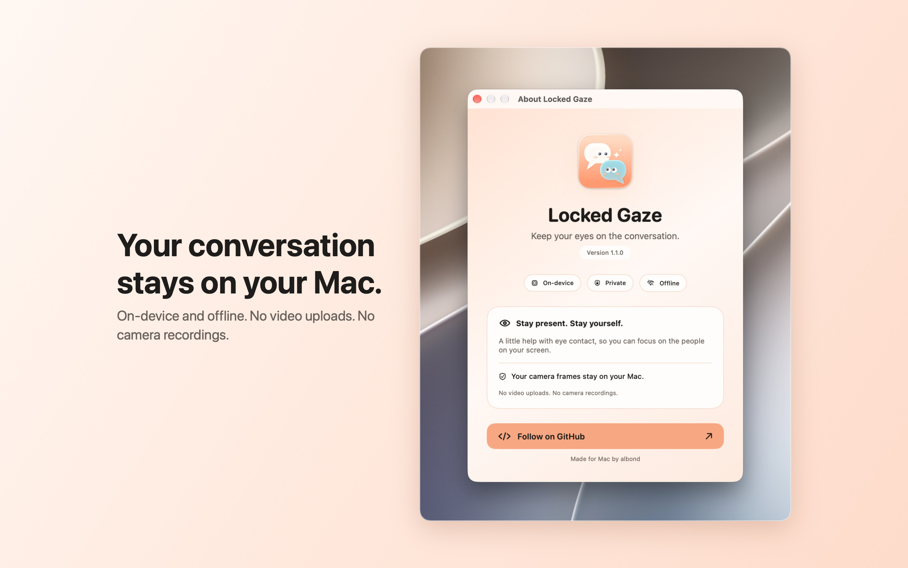
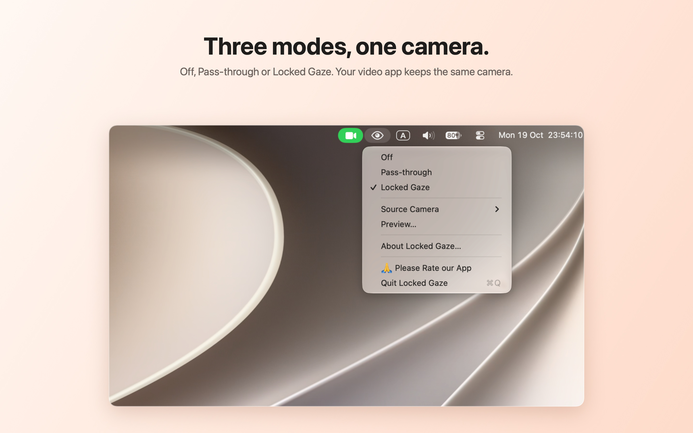
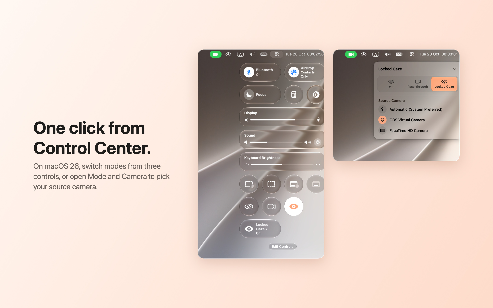
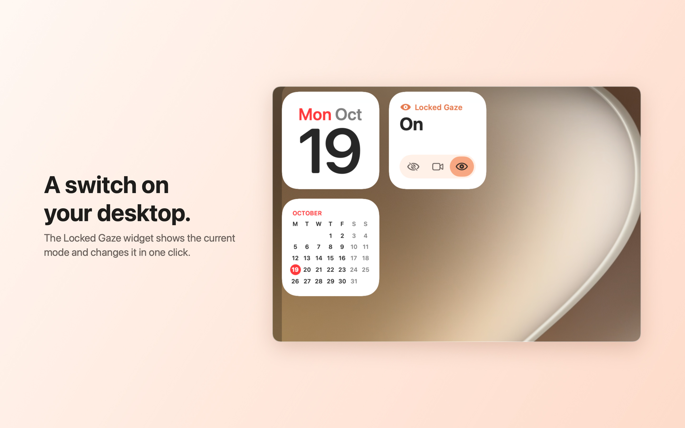

<p align="center">
  
</p>

<h1 align="center">Locked Gaze</h1>
<p align="center"><strong>Keep your eyes on the conversation.</strong><br>Eye-contact correction for your Mac. Private by design.</p>

<p align="center">
  <a href="https://apps.apple.com/app/id6814174298"></a>
</p>
<p align="center">Free. No subscriptions. No hidden payments.</p>

<p align="center">
  <a href="LICENSE"></a>
  <a href="#download-for-mac"></a>
  <a href="#download-for-mac"></a>
  <a href="https://developer.apple.com/documentation/swiftui"></a>
  <a href="CHANGELOG.md"></a>
</p>

<p align="center">
  <a href="#your-conversation-your-mac"></a>
  <a href="#your-conversation-your-mac"></a>
  <a href="#your-conversation-your-mac"></a>
  <a href="https://github.com/albond/locked-gaze"></a>
  <a href="#support-the-project"></a>
</p>

<p align="center">
  <a href="#a-small-app-with-a-clear-purpose">Features</a> · <a href="#your-conversation-your-mac">Privacy</a> · <a href="#three-simple-steps">How it works</a> · <a href="#download-for-mac">Download</a> · <a href="CHANGELOG.md">What's New</a> · <a href="https://github.com/albond/locked-gaze">Star on GitHub</a> · <a href="#support-the-project">Donate</a>
</p>

Reading notes, following a presentation, or watching the person on screen can pull your gaze away from the camera. Locked Gaze helps bring it back, so you can focus on what you want to say.

*Real screenshots of Locked Gaze 1.1.0. The camera shows a sample video.*



## Your conversation, your Mac

Your camera frames stay on your Mac. Eye-contact correction runs entirely on your device, without uploading video for processing. Locked Gaze does not record your camera feed.



## A small app with a clear purpose

- **Eye contact, with less effort.** Gaze correction designed for conversations, presentations, and interviews.
- **A home in your menu bar.** Switch between Off, Pass-through, and Locked Gaze whenever you like.
- **Pass-through when you need it.** Keep the Locked Gaze camera in a call and send your original video, with no camera switch.
- **One click from Control Center or the desktop.** On macOS 26 or later, add the Locked Gaze, Pass-through, and Locked Gaze Off controls side by side, add Mode and Camera for a panel with a three-way switch and your cameras, or put the Locked Gaze widget on your desktop.
- **See it before your call.** Preview shows your camera and the corrected view side by side, without starting a meeting. Nothing is recorded.
- **Your choice of camera.** Select a webcam or use your iPhone through Continuity Camera.
- **A camera you can select.** Choose **Locked Gaze** in video apps that support macOS virtual cameras.
- **Made for Apple Silicon.** Local processing built around your Mac.

## Three simple steps

After granting camera access and enabling the camera extension:

1. Keep **Automatic (System Preferred)** selected, or choose your source camera in Locked Gaze.
2. Choose **Locked Gaze** in the menu bar.
3. Select **Locked Gaze** as the camera in your video app.

Choose **Pass-through** to send your original video without leaving the Locked Gaze camera, or **Off** to stop the camera.



## One click from Control Center

On **macOS 26 or later**, add the **Locked Gaze**, **Pass-through**, and **Locked Gaze Off** controls to Control Center and place them side by side: the lit control shows the current mode, and clicking another one switches to it. **Mode and Camera** opens a panel with a three-way switch and the list of source cameras. The **Locked Gaze** desktop widget offers the same three-way switch in light, dark, tinted, and clear styles. You can also keep using the menu bar.





## Download for Mac

Locked Gaze is available **free on the Mac App Store**. Download the ready-to-use app with everything needed for on-device gaze correction included.

[Download Locked Gaze on the Mac App Store](https://apps.apple.com/app/id6814174298)

[What's new in 1.1.0](CHANGELOG.md#110): three modes with Pass-through, Control Center controls and a Mode and Camera panel, a desktop widget, Preview, support for Apple M2 and newer chips including MacBook Air, and a new look. The source version badge refers to this repository; the App Store page shows the version currently available to download.

[Follow Locked Gaze on GitHub](https://github.com/albond/locked-gaze) and give it a star to bookmark the project. The source edition includes the native application and model interface specifications. Model weights are not included; building a working gaze-correction app requires compatible models supplied separately.

Requires **macOS 14 Sonoma or later** and an **Apple M2 or newer chip**, including base, Pro, Max, and Ultra models. Camera access and approval of the Locked Gaze camera extension are required.

## Support the project

Locked Gaze is free, with no subscriptions or hidden payments. If you find it useful, [give the project a star](https://github.com/albond/locked-gaze) or leave an optional tip to support development. Donations do not unlock features; the app is complete for everyone.

### Tip jar

Support Locked Gaze with an optional donation:

```text
0xF734F20bFeB7ddb3f0519ADAfbBa056939c9C261
```

| Network | Accepted tokens |
| --- | --- |
| Polygon | USDC · USDT |
| Ethereum mainnet | USDC · USDT · EURC |

Choose one of these networks in your wallet and verify the recipient address before sending. Network fees are separate from the donation.

Thank you for helping keep Locked Gaze simple, private, and free.

## Project information

Original application source code and documentation are licensed under [MIT](LICENSE). Model weights and separately licensed third-party components are outside that grant; see [third-party notices](THIRD_PARTY_NOTICES.md).

[Model interfaces](Models/README.md) · [Privacy policy](PRIVACY.md) · [Security](SECURITY.md) · [Contributing](CONTRIBUTING.md) · [Code of conduct](CODE_OF_CONDUCT.md)
